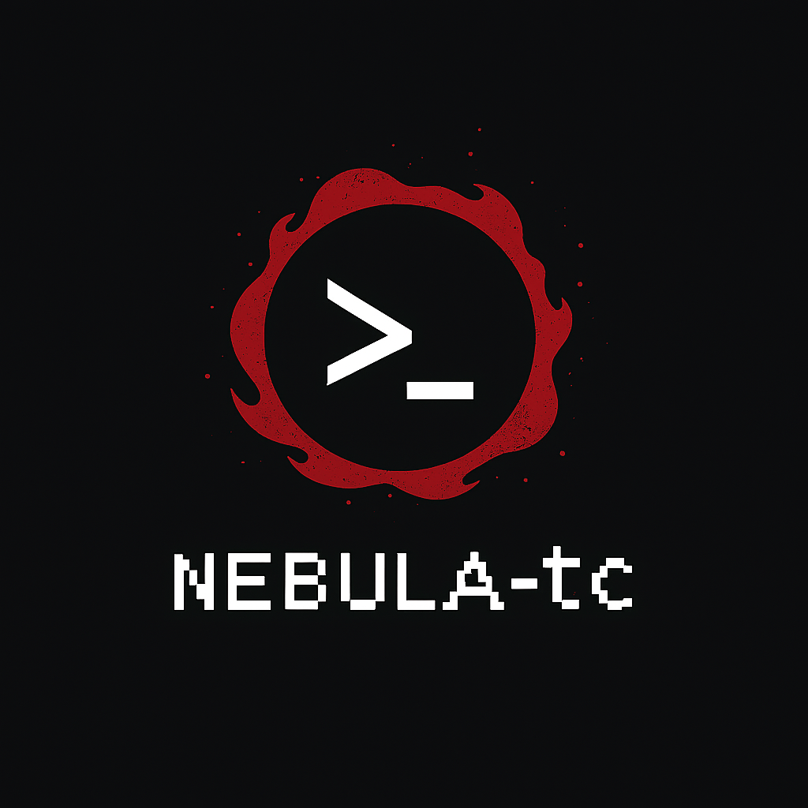
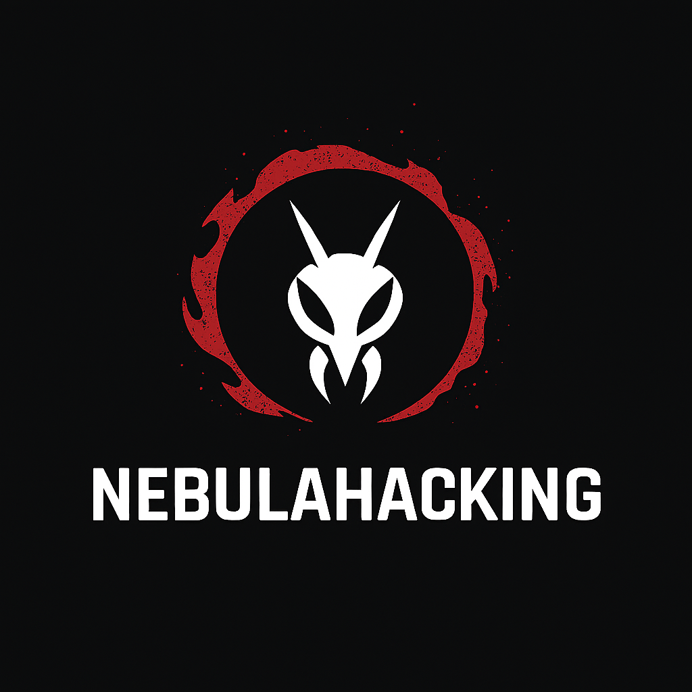

# Nebula Terminal (Version 2.0)

[](https://github.com/NebulaHacking/Nebula-Terminal-Custom/actions/workflows/tests.yml)

Nebula Terminal is an open-source Python project developed by the Nebula Cyber Security Team. It provides a modular terminal environment designed for learning, experimentation, and cybersecurity education through a Linux-inspired command-line interface.

<div align="center">
  
  
</div>

## Overview

Nebula Terminal combines a custom shell with a collection of utilities dedicated to networking, system administration, and cybersecurity. The project is designed as a modular platform where new commands and tools can easily be integrated.

What's new in 2.0 is listed in [CHANGELOG.md](CHANGELOG.md).

### Nebula IA — an auditable pentest copilot
- `ia` runs Nebula's own tools, reads their results, chains the next step and records findings with evidence and a fix
- Works with Claude, ChatGPT, Gemini, Mistral, Groq, DeepSeek, OpenRouter, or a local Ollama model (nothing leaves your PC)
- Network commands need your approval; inside a mission, the scope is enforced by the terminal itself, not by the prompt
- Every AI action is written to the mission's tamper-evident ledger; answers stream live, with a Stop button
- Playbooks: `ia audit web|tls|reseau|complet <target>` run a full audit inside the authorized scope
- Same conversation in the terminal and in the web dashboard

### Missions and client deliverables
- Authorized scope enforcement for every network tool (terminal, dashboard and AI)
- Hash-chained evidence ledger, change diff between two runs
- `mission retest`: replays the evidence of each finding and marks it fixed or still present
- Report in Markdown and HTML (print to PDF), with severity summary and a compliance table (nLPD, ISO/IEC 27001:2022, NIS2)

### Tools
- Recon: DNS, WHOIS, HTTP security headers, banner grabbing, TLS audit, subdomains, host discovery, port scan
- ShadowViper: IP / domain / URL / ASN / e-mail investigation (geolocation, ASN, WHOIS, DNS, ports, traceroute)
- NexarieScan: reflected XSS in URL parameters and forms (GET only unless `--post`)
- reqforge: HTTP workshop — send, replay, diff, export to curl / Python, passive response analysis
- tracewave: .pcap / .pcapng analyzer with automatic findings
- Crypto toolbox, file analysis, IP tracking, weather, wordlist generator
- Every tool returns structured results: same view in the terminal, the dashboard, and with `--json`

### Terminal
- Kali-style input: Tab completion and grey history suggestions
- Workspace file system with Linux-style commands, redirection (`>`), aliases and scripts
- 8 themes (`theme` shows a preview); tool banners follow the theme's gradient
- Prompt shows when the last command failed or was slow
- Live web dashboard (`nebulaGui`): activity feed, console, tool forms, Nebula IA
- Guided tour (`tuto`)

## Project Goals

The primary objectives of Nebula Terminal are:

- Learn Python through a large-scale project
- Explore networking and cybersecurity concepts
- Build an extensible terminal framework
- Provide a safe environment for experimentation

Nebula Terminal is intended for educational purposes and should only be used on systems you own or are authorized to test.

## Requirements

- Python 3.11 or later
- Windows or Linux

## Installation

```bash
git clone https://github.com/NebulaHacking/Nebula-Terminal-Custom.git
cd Nebula-Terminal-Custom
python launch.py
```

`launch.py` creates the virtual environment, installs the core dependencies and starts Nebula.
Optional tools (ShadowViper's local model, IP map, Qt browser, OSINT, game) are installed with:

```bash
python launch.py --full
```

Without them, the related command tells you the exact `pip install` line to run.

As a package (editable install, adds a `nebula` command):

```bash
pip install -e ".[all]"
```

API keys for Nebula IA go in `.env` (see `.env.example`), or type `ia key claude` inside Nebula.

## Running

```bash
python launch.py           # or: nebula
python launch.py --version
python launch.py update    # checks GitHub for a newer version and installs it (update --check: only check)
```

Add the project folder to your PATH to type `nebula` from anywhere (`nebula.cmd` on Windows, `nebula` on Linux / macOS).

## License

This project is released under the MIT License.

## Status

Nebula Terminal is under active development. Features, architecture, and documentation may evolve over time.
